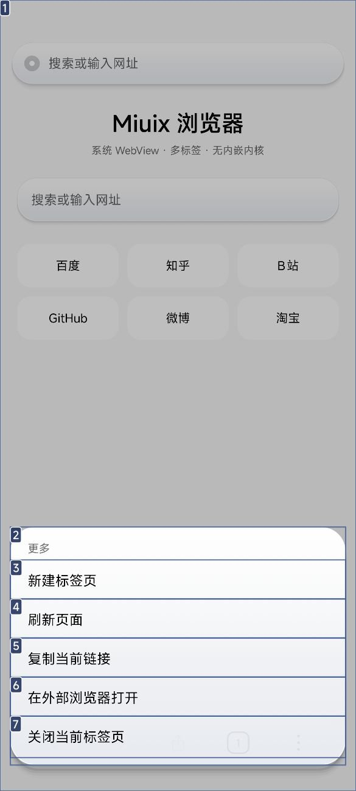

# Mafari 浏览器

基于 **MIUIX（Compose Multiplatform 版）** 的 Android 浏览器，网页渲染用**系统 WebView**，不内嵌 Chromium 内核：安装包小（debug ≈ 11.6 MB），能跟随系统 WebView 一起更新。

| 主页 | 网页 | 弹层 |
| --- | --- | --- |
|  |  |  |

## 界面（iOS Safari 风格）

- **全屏沉浸**：网页铺满整屏，画到状态栏和手势小白条下面；底栏留出 `navigationBarsPadding()`，小白条始终可见。
- **Mafari** 字标：居中、58sp、Black 字重、每字母一色（Google 风格）
- **单条悬浮玻璃底栏**：地址胶囊嵌在栏中间，两侧是 `‹` `›`、标签页（带数量角标）、更多。
- **主页收藏可编辑**：主页「收藏」右侧的「编辑」，可长按改名/改网址、点 × 删除、+ 添加收藏，数据存在 SharedPreferences 里。
- **动效**：按钮按下缩放（弹簧）、底栏随滚动下沉 + 淡出 + 轻微缩放、弹层滑入、加载小圆点呼吸。
- **模糊**：PixelCopy 抓底栏区域 → 缩到 1/8 → 放大绘制，再叠半透明底色和高光描边；设置里可关。
- **弹窗**：收藏编辑 / 自定义 DoH 都走 MIUIX `OverlayDialog`（外层套 MIUIX `Scaffold` 提供宿主）。注意采样图层里不能放 WebView，否则页面会闪烁；现在采样层只有 Compose 背景。

## 功能

- 多标签页：底栏标签按钮打开面板，切换 / 关闭 / 新建；每个标签独立 WebView 与状态
- 地址栏：自动区分网址与搜索词（搜索走百度），回车即加载
- 后退 / 前进 / 刷新 / 停止、加载进度、加载失败页
- 主页：搜索框 + 常用站点宫格
- 长按链接：打开、新标签打开、复制链接、外部浏览器打开
- 文件下载交给系统 DownloadManager；`alipay://`、`weixin://` 等外部协议交给系统
- 跟随系统深色模式（MIUIX `ThemeController` + 自定义玻璃配色）

## 设置（MIUIX Preference）

「更多 → 设置」进入 KernelSU 那种 MIUIX 设置页：

- **底栏柔光玻璃**：`SwitchPreference`，关掉后底栏只保留半透明底色
- **关于**：版本与依赖说明

> 网页本身由系统 WebView 解析域名，选择的自定义 DNS 目前应用在应用内请求（如收藏图标抓取）上。

## 技术栈

| 项目 | 版本 |
| --- | --- |
| MIUIX (`top.yukonga.miuix.kmp`) | 0.9.4 |
| Kotlin / Compose Multiplatform | 2.4.20 / 1.12.0 |
| AGP / Gradle | 9.4.1 / 9.7.1 |
| compileSdk / targetSdk / minSdk | 37 / 36 / 26 |

> AGP 9 起 Kotlin 内置，工程不再应用 `org.jetbrains.kotlin.android`，只应用 `org.jetbrains.kotlin.plugin.compose`。

## 目录

```
app/src/main/java/dev/dsh/miuixbrowser/
├── MainActivity.kt   # 入口、全屏沉浸（透明系统栏 + 深浅色图标）
├── BrowserState.kt   # BrowserTab（每标签一个 WebView）/ BrowserState（多标签）
└── BrowserScreen.kt  # 悬浮玻璃地址胶囊、悬浮底栏、主页、弹层
.github/workflows/build.yml   # 推到 GitHub 自动出 APK
```

## 构建

```bash
# 需要 JDK 17+ 和 Android SDK（platforms;android-37.0、build-tools;36.0.0）
./gradlew :app:assembleDebug
# 产物：app/build/outputs/apk/debug/app-debug.apk
```

Android Studio 直接打开本目录也可以；推 GitHub 后 Actions 里能下 `miuix-browser-debug`。

## 关于模糊的三个坑

1. **按钮「点了没反应」**：弹层刚出现时，打开它的那一次点击的抬手事件会落到遮罩/列表上，弹层一闪就被关掉（早期用库的 `OverlayBottomSheet` 时更明显）。
   现在弹层在同一个 Compose 窗口里自绘，并且弹出后的 220ms 内吞掉所有触摸（`pointerInput` + `armed` 状态），
   遮罩和行按钮都在这之后再响应。
0. **MIUIX 的 `miuix-blur`（backdrop）不能用在 WebView 上**：它把下层画面录进 GraphicsLayer 再模糊，
   而 WebView 是系统 View、录不进去；强行使用时底栏会被画成全透明，页面一渲染还会崩。
   所以改成「快照模糊」：`webView.draw(canvas)` 缩到 1/12 再放大绘制，更新频率 ~5Hz。
2. **白底网页上玻璃看不见**：只靠 `Modifier.shadow` 在 MIUI 上几乎看不到，改成在 `drawBehind` 里手绘 4 层柔光投影 + 顶部高光 + 内外两道描边。

## 关于「真·模糊」

网页是系统 WebView 的独立 View 图层，Compose 的 backdrop/`layerBackdrop` 采样不到它的像素，
所以底栏的玻璃是「半透明 + 高光 + 描边 + 投影」的静态玻璃，而不是实时高斯模糊。
要做真模糊，需要另外截 WebView 画面（`webView.draw(canvas)` 到 bitmap）再模糊后画到栏底下，代价是滚动时掉帧，暂未做。

## 脚本（兼容油猴元数据）

「更多 → 脚本」可以新建一段 JavaScript，在页面加载完成后通过 `evaluateJavascript` 注入。支持 `// ==UserScript==` 里的 `@name` / `@match` / `@include` 自动识别，按 URL 匹配注入；支持从 URL 导入 `.user.js` 并一键更新。
注意：没有实现 `GM_*` 运行时 API 和 `@require`，复杂脚本可能跑不起来。

## 浏览器功能

- 更多面板（图标宫格，可长按拖动排序）：主页 / 下载 / 扩展 / 历史 / 请求桌面网站 / 查找页内 / 翻译 / 收藏 / 分享 / 刷新 / 复制链接 / 外部打开 / 新建标签 / 关闭标签 / 设置
- 设置：底栏柔光玻璃开关、自定义 UA（4 个预设 + 任意字符串，所有标签生效）、下载列表
- 状态栏：打开页面时内容从状态栏下方开始；向下滚动时内容顶到状态栏（沉浸）；滑回顶部自动回落

## 已知限制

- 没有书签 / 历史 / 下载列表（下载在系统通知栏）
- 标签不做进程重建恢复（App 被系统杀掉后标签丢失）
- 全屏视频、文件选择器（`onShowFileChooser`）未接


## 构建说明

```bash
./gradlew :app:assembleDebug     # debug 包
```

release 签名使用根目录 `mafari-release.jks`（alias `mafari`，口令 `mafari123`，仅用于本项目）。
当前 AGP 9.4.1 在本机产出的 `app-release.apk` 缺少 `AndroidManifest.xml`（打包异常），
因此 `mafari-2.1.0-release.apk` 是用 release 密钥对构建产物重新签名得到，可直接安装。


## 发布到 GitHub 并自动出包

### 1. 推到 GitHub

```bash
cd miuix-browser
git init
git add .
git commit -m "mafari browser"
git branch -M main
git remote add origin https://github.com/<你的用户名>/<仓库名>.git
git push -u origin main
```

### 2. 配置签名 Secrets（Settings → Secrets and variables → Actions）

| Secret | 内容 |
| --- | --- |
| `KEYSTORE_BASE64` | `base64 -w0 mafari-release.jks` 的结果 |
| `STORE_PASSWORD` | keystore 口令（本项目是 `mafari123`） |
| `KEY_ALIAS` | `mafari` |
| `KEY_PASSWORD` | key 口令（同上） |

### 3. 打 tag 自动发布

```bash
git tag v3.2.0
git push origin v3.2.0
```

推送 tag 后 `.github/workflows/release.yml` 会：
1. 构建 debug + release
2. 检查 release 包是否有效（AGP 在本地产物可能缺 manifest，CI 上正常）
3. 无效时改用 debug 包 + `apksigner` 重新签名
4. 上传 artifacts，并自动创建一个 GitHub Release，把 APK 挂上去
