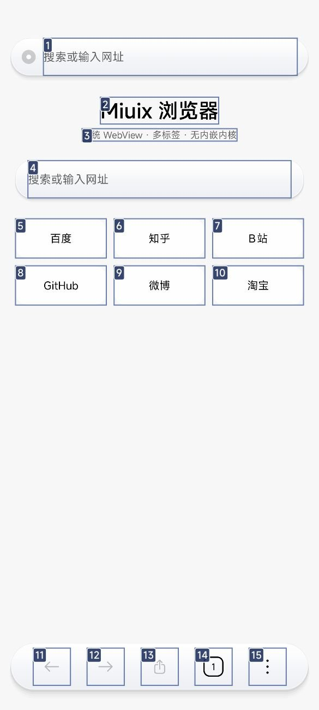
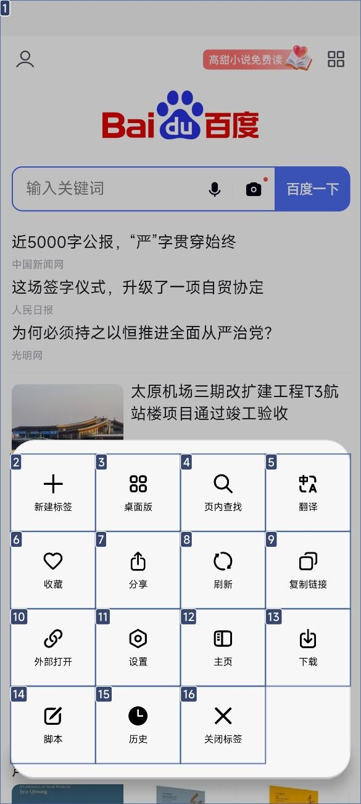
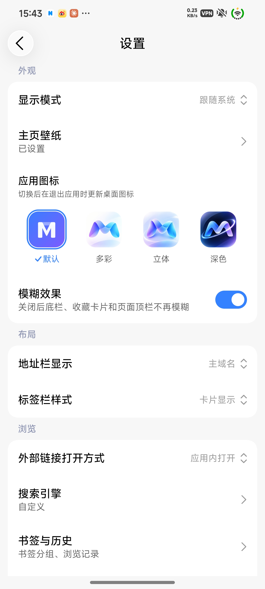

# Mafari

基于 **MIUIX**（Compose Multiplatform）+ **系统 WebView** 的 Android 浏览器。不内嵌 Chromium 内核，安装包约 1.5 MB（R8 精简后）。

## 界面

| 主页 | 更多面板 | 设置 |
| --- | --- | --- |
|  |  |  |

| 网页 |
| --- |
|  |

- 单条悬浮玻璃底栏：`‹` `›` + 地址胶囊 + 标签页 + 更多
- 主页液态玻璃字标、收藏（带 favicon、可编辑、OS4 玻璃材质）
- 全部弹层走 MIUIX 规范：`OverlayDialog` / 自制面板（spring 滑入）
- 状态栏：初始留白，向下滚动顶满，回顶回落

## 功能

**浏览**
- 多标签（文字列表 / 卡片两种样式）、前进后退刷新、加载进度
- 地址栏可选显示：网站标题 / 主域名 / 完整域名
- 下拉刷新（4cm 触发，顶部有刷新动画）
- 页面内查找、翻译、分享、复制链接、外部浏览器打开、长按链接菜单
- 首页打开网页后，后退可回到主页

**脚本（油猴）**
- 支持 `@name` / `@match` / `@include` / `@run-at` 元数据
- `document-start` 脚本在页面可见时注入，其余在加载完成注入
- GM API 垫片：`GM_setValue/getValue/deleteValue/listValues/addStyle/xmlhttprequest/notification/openInTab/registerMenuCommand/info`、`unsafeWindow`
- 从 URL 导入 `.user.js`、一键更新；自动识别 `.user.js` 链接并弹导入确认

**下载**
- 内置下载器（不走系统下载器），先写缓存再入库到 `/sdcard/Download/mafari`
- 4 线程分段下载（服务器支持 Range 时）、断点续传、暂停/继续、失败重试、删除记录与文件
- 前台服务 + 进度通知；按小米官方文档接入**超级岛**（`miui.focus.param`，仅在开始下载时上岛）

**其他**
- 收藏 / 历史（最多 300 条）/ 下载管理 / 脚本管理
- 设置：显示模式（跟随系统/日间/夜间）、主页壁纸、玻璃效果、搜索引擎、自定义 UA、检查更新
- 网页弹窗（`window.open`）在当前标签打开

## 部署

### 本地构建

```bash
# 需要 JDK 17+、Android SDK（platforms;android-37.0、build-tools;36.0.0）
./gradlew :app:assembleDebug     # app/build/outputs/apk/debug/app-debug.apk
```

### GitHub Actions 自动发布

推 tag 即自动构建并创建 Release：

```bash
git tag v3.3.0 && git push origin v3.3.0
```

可选签名 Secrets（不配也能出 debug 包）：

| Secret | 内容 |
| --- | --- |
| `KEYSTORE_BASE64` | `base64 -w0 your.jks` |
| `STORE_PASSWORD` | keystore 口令 |
| `KEY_ALIAS` | key 别名 |
| `KEY_PASSWORD` | key 口令 |

## 项目地址

https://github.com/rosenii/mafari
